# 🥋 +1 Kung Fu Chop! — a Roblox +1 simulator (Stone Skipping style)

Train your chop, then **smash through a wall of boards** as far as your Strength takes you.
One big studded hub, laid out like *+1 Stone Skipping*:

* **Right side – training floors.** Like the ponds in Stone Skipping: small pools side by side,
  each with a pad at the near end. **Stand on a pad** and you train automatically: your
  character chops a slash at the floor's item (wooden boards → bamboo → ice → bricks → gold bars
  → obsidian → star crystals), which shatters into the water, and every chop gives
  **+Strength**. Everyone else on your pad is hidden for you, so it feels like your own floor.
  This is the only way to gain Strength (no clicking). Better floors (x4, x10, x20) unlock with
  rebirths; x30 / x75 / x200 floors are Robux passes.
* **Centre – the Board Wall lane.** Step on the launch pad and press **E** to smash. Your character
  flies down the lane and breaks every wall your Strength can handle through 6 biomes (Bamboo
  Grove → Autumn Temple → Frost Peak → Lava Fortress → Sky Palace → Cosmic Rift). Every broken
  wall pays **Wins**.
* **Left side – hand items.** Wraps, gloves and gauntlets unlock with lifetime Wins (+1, +3, +5,
  +12, +30 … per chop). Like the shells in Stone Skipping.
* **Behind spawn – eggs, pets and leaderboards.** Spend Wins on eggs for pets that multiply your
  Strength. There's a Robux Rainbow Egg, a "Best in game" pet showcase, and global top-10 boards.
* **Rebirth** at Level 40 resets Strength for a permanent multiplier and new zones.
* Gifts (playtime rewards), "Welcome back" offline training, 2x boosts, trails, friend boost,
  Auto Smash (automatic wall runs) and a Robux shop are all included.

| Hub | Board Wall lane | Training floors |
|---|---|---|
| 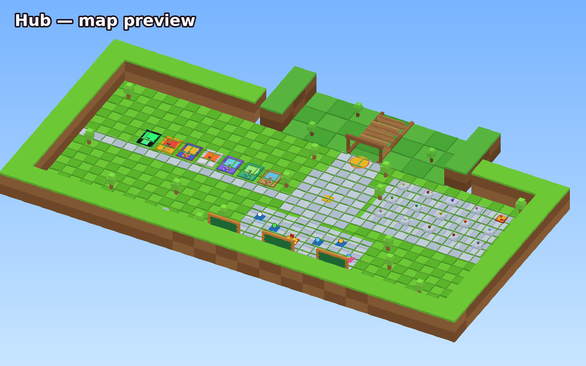 | 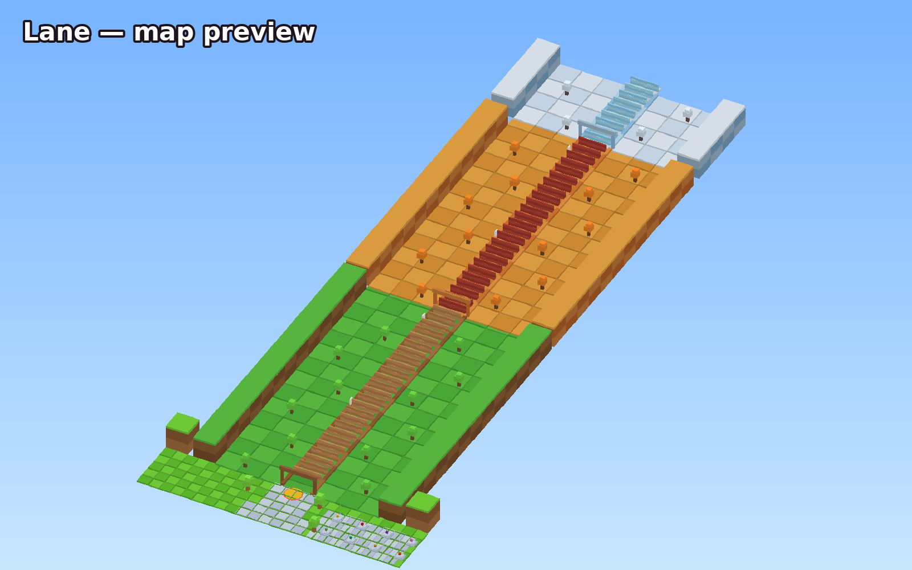 | 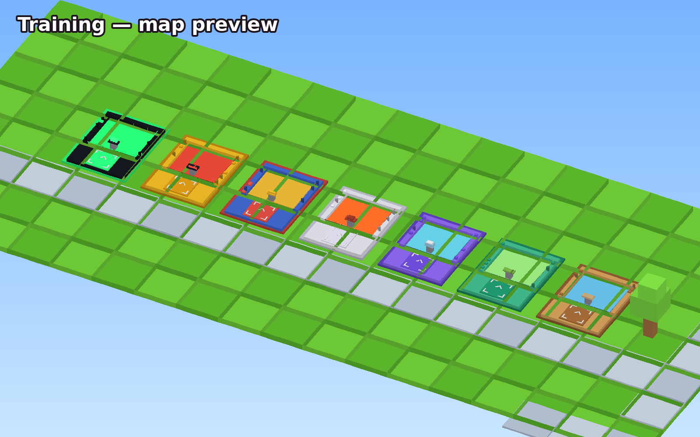 |

<sub>Flat-shaded previews of `Workspace.Map` (rendered by `tools/mapgen/render_preview.py`). In Studio you see the real map with studs, lighting and effects.</sub>

| HUD | Playtime Rewards | Shop |
|---|---|---|
| 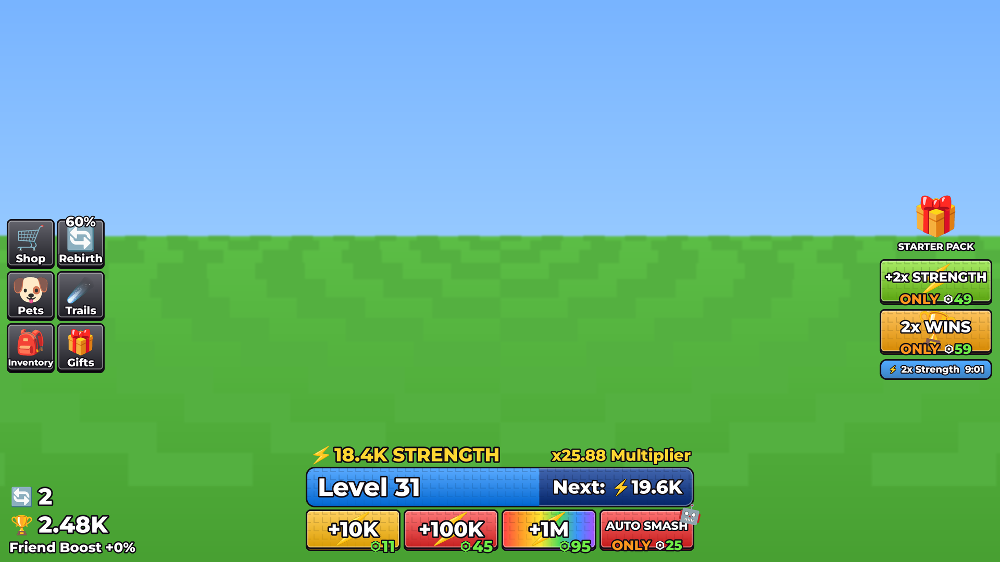 | 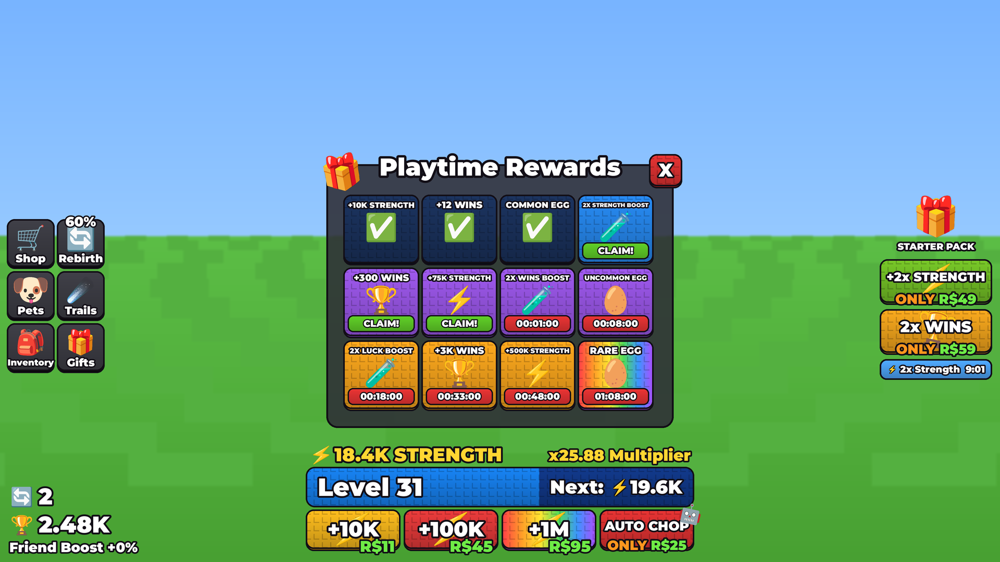 | 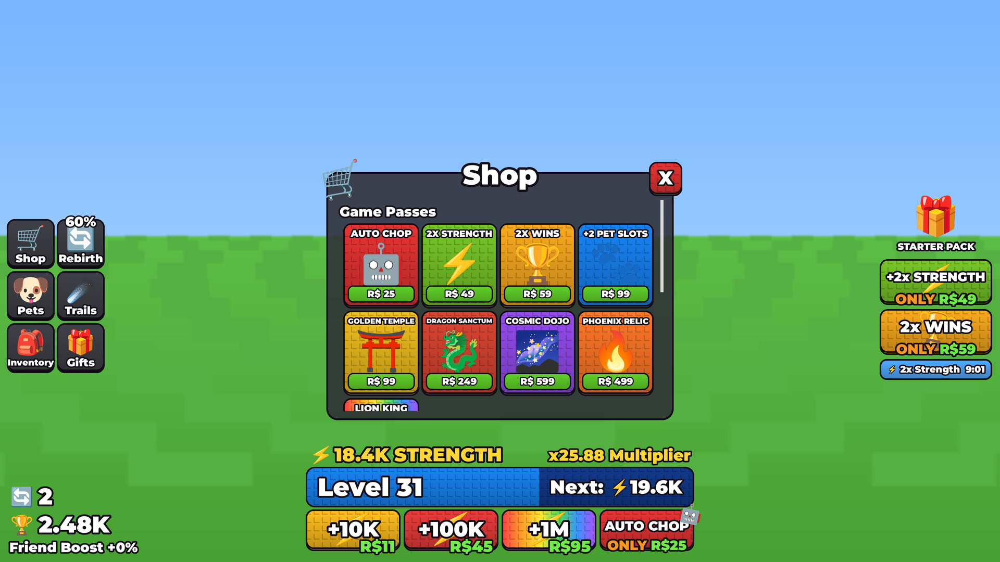 |
| **Pets** | **Rebirth** | **Welcome Back** |
| 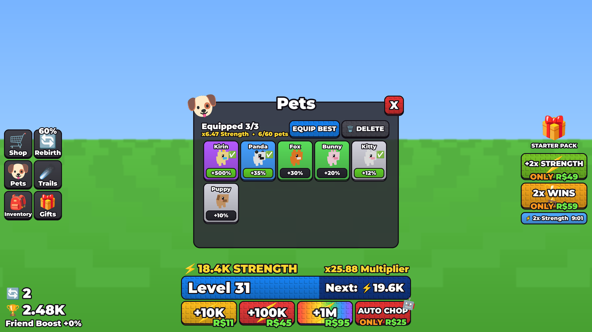 | 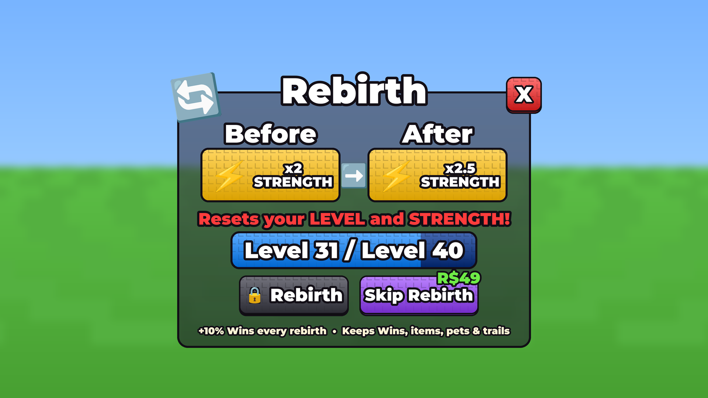 | 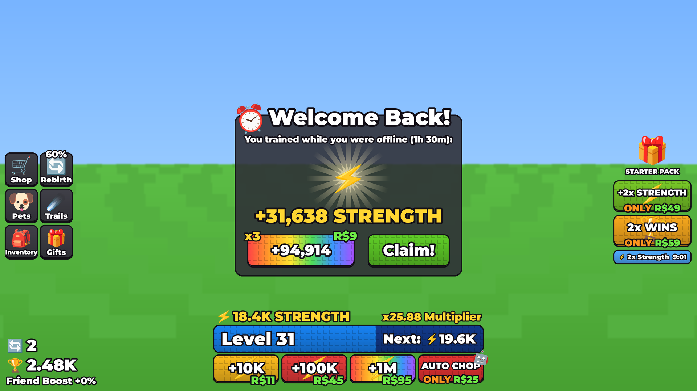 |

<sub>The real UI code rendered offline by `tools/uipreview/render_ui.py` (an approximation of Roblox's renderer: emoji and 3D pet previews will look slightly different in game).</sub>

---

## ▶️ Open it in Roblox Studio

1. Download **`KungFuChop.rbxl`** from this repo. On GitHub, click the file and then **Download raw file**.
2. Double-click it, or in Roblox Studio use **File → Open from File…** (Ctrl+O).
3. The whole map is already in **Workspace → Map**. Move, recolour or redecorate anything you like.
4. Press **Play** (F5).

**Saving progress** only works in a published place: *File → Publish to Roblox*, then
*Game Settings → Security → Enable Studio Access to API Services*. Until then the game runs on
in-memory data and shows a "progress won't be saved" message. Leaderboards also need publishing.

## 🎮 How to play

| Action | How |
|---|---|
| Train (+Strength) | Stand on the pad of a training floor. Step off to stop |
| Smash the wall | Stand on the yellow launch pad and press **E** (or tap the **Smash!** prompt) |
| Equip hand items | Walk up to a pedestal and press **E**, or use **Inventory** |
| Hatch eggs | Walk up to an egg and press **E** |
| Menus | Shop, Rebirth, Pets, Trails, Inventory, Gifts (left side) |

All numbers (zone multipliers, item bonuses, wall toughness, wins per biome, egg odds, pet
bonuses, rebirth cost, gifts, prices) live in **`src/shared/Config.luau`**. In Studio you'll find
it at **ReplicatedStorage → Shared → Config**.

---

## 🧱 Studs

**The UI has blocky square studs out of the box**, like +1 Stone Skipping: every button, bar and
tile gets a continuous grid of small square studs (a soft dark "L" on each), built from plain
Frames in `src/client/UI/StudBackground.luau`. They take the colour of the surface they sit on
and run edge to edge. There's nothing to upload.

**Optional: square studs on the map.** Out of the box the map parts use Roblox's built-in round
studs. For the square studs from Stone Skipping and Steal an Egg (the dark "L" bevel on each
stud), upload one image:

1. In Studio: **View → Asset Manager → Bulk Import**, and pick `assets/textures/stud_overlay.png`.
2. In the Asset Manager's *Images* folder, right-click it and choose **Copy Asset ID**.
3. In **ReplicatedStorage → Shared → Config**, paste it:
   ```lua
   StudTexture = "rbxassetid://1234567890",
   ```
4. Press Play. Every studded part switches to square studs, and the UI panels switch to the
   tiled image (ImageLabel, ScaleType Tile, TileSize 32×32). To see it in edit mode too, run this once in the **Command Bar**:
   ```lua
   require(game.ServerScriptService.Server.Modules.MapBuilder).ApplyStudTextures(workspace.Map)
   ```

> ⚠️ Use the **image** ID. An ID copied from a *Decal* page on the website is a different asset
> and shows up blank.

| Stud tile | Floor | UI panel (TileSize 32×32) |
|---|---|---|
|  | 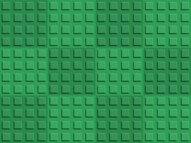 | 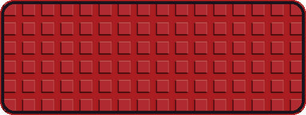 |

**Studded UI background by hand (Steal an Egg style):** put an **ImageLabel** inside the panel
Frame, set **Image** to the stud texture, **ScaleType = Tile** and
**TileSize = UDim2.new(0, 32, 0, 32)**.

---

## 💸 Robux items (placeholders)

Everything in the shop is built and shown in the game: Auto Smash, 2x Strength, 2x Wins, +2 Pet
Slots, the three Robux training zones, Phoenix Relic, the Lion King pet, Strength packs
(+10K / +100K / +1M), Rainbow Egg, Starter Pack and the x3 offline claim.

* **In Studio** buying anything grants it instantly (`Config.Monetization.StudioTestPurchases = true`),
  so you can test every feature for free.
* **To sell for real:** on the Creator Hub, open your experience → *Monetization* → create the
  **Passes** and **Developer Products**, then paste their ids into `Config.Monetization`
  (`Id = 0` means "not set up yet"). Prices in Config are only what the UI displays; the real
  price is the one you set on the Creator Hub.

---

## 🗺️ Editing the map

`Workspace.Map` comes from `src/workspace/Map/*.model.json`. Those files are **baked** from the same
Luau code the game uses (`src/server/Modules/MapBuilder.luau`).

* Edit freely in Studio. Gameplay only needs these names: `TrainingZones/Zone_<Id>/Area`,
  `TrainingZones/Zone_<Id>` (a `ZoneId` attribute) with its `TrainPad` part (its front faces
  the pool) and the `Target` model (the item that gets chopped), `Lane/LaunchPad`, `Lane/Walls/Wall_<n>`, `Items/Item_<Id>`, `Eggs/Egg_<Id>`, `Showcase` and
  `Leaderboards/<BoardId>/Panel`.
* If `Workspace.Map` is deleted, the server rebuilds it at startup.
* After changing zones, items, eggs or biomes in Config, re-bake with
  `python3 tools/mapgen/build_map.py` (needs the [Luau CLI](https://github.com/luau-lang/luau/releases)).

> If you use `rojo serve`, the next sync overwrites Studio edits to `Workspace.Map`. Save your
> edits back into the model files, or stop syncing the map.

---

## 🧩 Architecture

```
default.project.json   Rojo project (scripts, map, lighting)
KungFuChop.rbxl        Ready-to-open place built from this repo
src/shared/            → ReplicatedStorage.Shared
  Config, Formulas     all tunables + the progression math (server truth, client previews)
  Remotes              every RemoteEvent / RemoteFunction
  PetModels, ItemModels blocky pet + hand item models built from parts
  TrainingPads         where the training pads are / who stands on one (server + client)
  StudSurface          square-stud Texture (or round-stud fallback) on any part
src/server/            → ServerScriptService.Server
  Services/DataService         session-locked DataStore profiles, autosave, replication
  Services/WorldService        loads Workspace.Map, lighting, zone detection
  Services/TrainingService     training floors: Strength for standing on an unlocked pad
  Services/LaneService         board wall runs: walls broken, distance, wins
  Services/PetService          eggs, hatching, equip / delete
  Services/ProgressService     wins, hand items, trails, rebirth
  Services/RewardsService      gifts, offline training, boosts
  Services/MonetizationService passes, products, ProcessReceipt
  Services/LeaderboardService  global top-10 boards
  Services/SocialService       friend boost
  Services/AvatarService       hand wraps, trails, walk speed
  Services/ActionService       one validated remote for every player request
  Modules/MapBuilder           builds the hub (used offline by the baker + as a fallback)
src/client/            → StarterPlayerScripts.Client
  Controllers/ChopController   keeps the chop animation bound (used by wall runs)
  Controllers/TrainingController training pads: chop + slash in step with the server, items
                               shatter, other players on your pad are hidden
  Controllers/LaneController   the wall run: flight, shattering walls, camera, distance
  Controllers/PetController    everyone's pets following them
  Controllers/WorldController  pedestal / egg / showcase prompts, live signs
  Controllers/UIController     HUD + windows wiring
  UI/                          Theme, StudBackground (square studs), StudPanel, ChunkyButton,
                               MenuWindow (window + tiles), Hud, Menus/*, HatchOverlay, WelcomeBack
src/workspace/Map/     the baked hub map
assets/textures/       stud_overlay.png (upload this), checker_overlay.png, stud_tile.png
tools/                 stud texture generator, map baker + preview renderer,
                       uipreview/ (renders the UI offline; bundled OFL/Apache fonts)
tests/                 offline Luau unit tests for the game math
```

**Security:** the client only ever says "start my run" or "I'd like to buy/equip X". Training
needs no request at all: the server checks where your character stands. The server computes
every number, checks you're on the launch pad, validates
ownership, prices and unlocks on every request, and grants Robux products idempotently.

## 🛠️ Development

```bash
rokit install                      # rojo, selene, stylua, luau-lsp (see rokit.toml)
rojo serve                         # live-sync into Studio (Rojo plugin → Connect)
rojo build -o KungFuChop.rbxl      # rebuild the place file
python3 tests/run.py               # unit tests (needs the Luau CLI)
python3 tools/mapgen/build_map.py  # re-bake Workspace.Map
python3 tools/uipreview/render_ui.py  # render the UI to docs/ui/*.png (needs Pillow + Luau CLI)
selene src && stylua src           # lint + format
```
