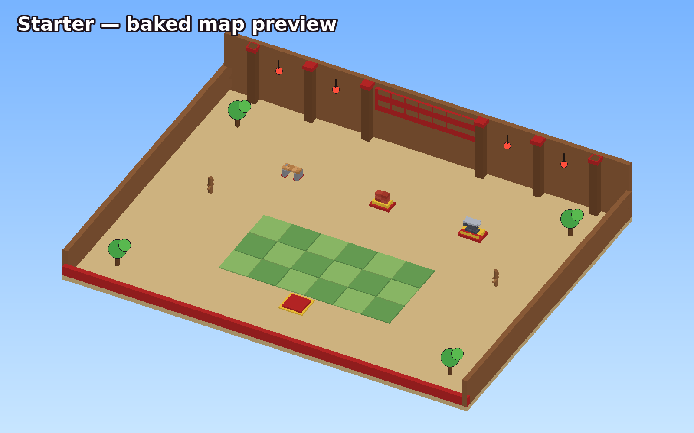
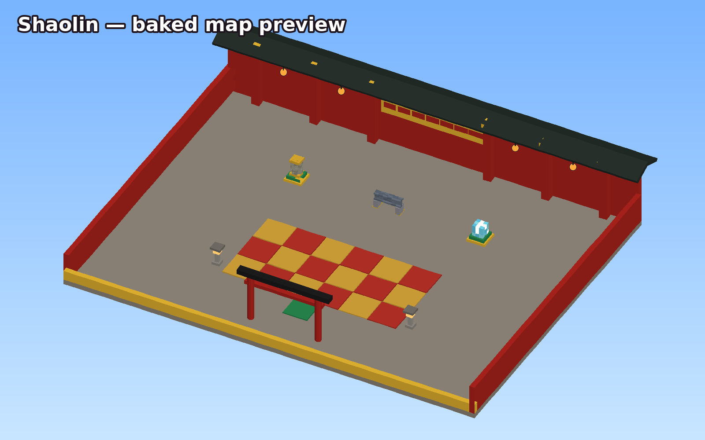
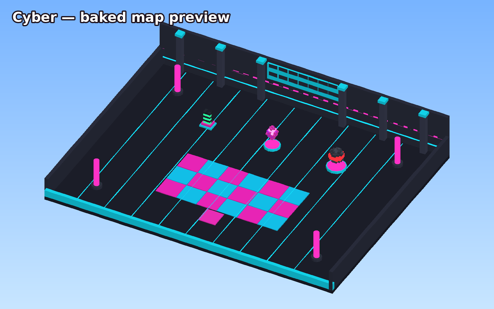
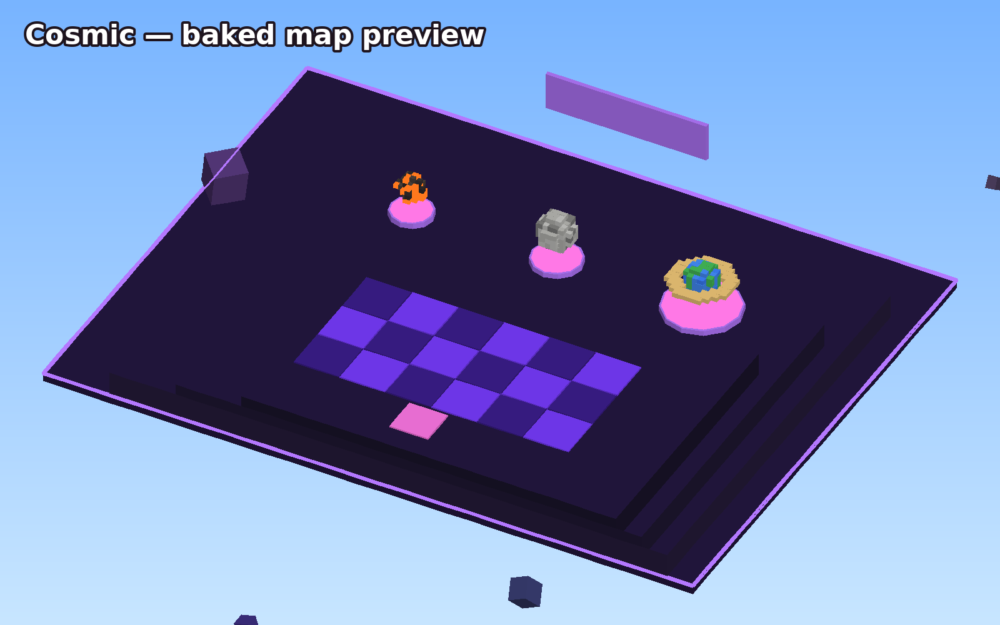

# 🥋 Kung Fu Chop! — a +1 incremental simulator for Roblox

Click to karate-chop, gain **+1 Power** per chop, and smash increasingly absurd objects
(boards → bricks → anvils → steel beams → diamonds → meteorites → planets) for coins. Spend
coins on **belts**, **hand auras** and **upgrades**, then **rebirth** to unlock new stud-themed
dojos. No pets: progression comes from ranks, auras and rebirths.

Everything is built in the classic **stud style**: square-stud plastic surfaces, chunky studded
UI panels in the style of *Steal an Egg*, and objects that shatter into stud debris.

| Starter Dojo | Shaolin Temple |
|---|---|
|  |  |
| **Cyber Dojo** | **Cosmic Void** |
|  |  |

<sub>Flat-shaded previews of the map in `Workspace.Dojos` (rendered by `tools/mapgen/render_preview.py`). Studio shows the real thing with studs, lighting and VFX.</sub>

---

## ▶️ Play it in Roblox Studio (no tools needed)

1. Download **`KungFuChop.rbxl`** from this repo and double-click it (or *File → Open from File* in Roblox Studio).
2. The whole map is already in **Workspace → Dojos** (Starter, Shaolin, Cyber, Cosmic) — move, recolour or redecorate anything.
3. Press **Play** (F5). Click / tap to chop, walk up to a stand and chop to smash it.

**Saving progress:** DataStores only work in a published place. *File → Publish to Roblox*, then
*Game Settings → Security → Enable Studio Access to API Services*. Until then the game runs with
in-memory data and shows a "progress won't be saved" toast.

### Make the studs square (one upload, ~1 minute)

Out of the box the parts use Roblox's built-in round studs. For the square stud look from
*Steal an Egg* / *Steal a Brainrot* (dark "L" bevel on each stud):

1. In Studio: **View → Asset Manager → Bulk Import** and pick `assets/textures/stud_overlay.png`
   (optionally also `checker_overlay.png` for the 4×4-stud checkerboard floors).
2. In the Asset Manager's *Images* folder, right-click the image → **Copy Asset ID**.
3. Open **ReplicatedStorage → Shared → Config** and paste it:
   ```lua
   StudTexture = "rbxassetid://1234567890",
   CheckerTexture = "rbxassetid://1234567891", -- optional
   ```
4. Press Play. Every studded part and every UI panel switches to the square studs.
   To see it in edit mode too, run this once in the **Command Bar**:
   ```lua
   require(game.ServerScriptService.Server.Modules.MapBuilder).ApplyStudTextures(workspace.Dojos)
   ```

> ⚠️ Use the **image** ID. An ID copied from a *Decal* page on the website is a different
> asset and shows up blank in an `ImageLabel`.

| Stud tile (1 stud) | Floor with 4×4 checker | UI panel (TileSize 32×32) |
|---|---|---|
|  |  |  |

### The studded UI background (Steal an Egg style)

`src/client/UI/StudBackground.luau` builds every panel background exactly like this. You can
repeat it by hand in Studio:

1. Create an **`ImageLabel`** inside the UI `Frame` panel (Size `{1,0},{1,0}`, BackgroundTransparency `1`, ZIndex below the content).
2. Set **`Image`** to the seamless stud texture asset ID (`Config.Assets.StudTexture`).
3. Set **`ScaleType = Enum.ScaleType.Tile`**.
4. Set **`TileSize = UDim2.new(0, 32, 0, 32)`**.

Add a `UICorner` matching the panel so the studs follow the rounded corners. Until a texture is
configured, the panels draw a procedural grid of square studs with the same 32px pitch.

---

## 🎮 Gameplay

**Controls:** left-click / tap the world, press **F** or **R2**, or hit the big **CHOP!** button.
Chopping next to a stand you're strong enough for smashes it.

### Core loop
1. **Train:** every chop = `(1 + Iron Palms) × belt × aura × rebirth × dojo` Power, with a chance to **CRIT** for ×3.
2. **Smash:** stand within range of an object with enough Power → it shatters into stud debris, camera shake, coins. It respawns for you after a few seconds (each player breaks their own copy).
3. **Progress:** spend coins on belts, auras and upgrades; rebirth for permanent multipliers and new dojos.

### Breakable objects
| Dojo | Object | Power needed | Coins |
|---|---|---|---|
| Starter Dojo | Wooden Board · Brick Stack · Iron Anvil | 50 · 500 · 5K | 5 · 30 · 150 |
| Shaolin Temple (1 rebirth) | Stone Pillar · Steel Beam · Diamond Block | 25K · 100K · 500K | 600 · 2K · 8K |
| Cyber Dojo (3 rebirths) | Server Rack · Neon Crystal · Mech Reactor Core | 2.5M · 12M · 60M | 30K · 120K · 500K |
| Cosmic Void (6 rebirths) | Meteorite · Moon · Planet | 300M · 2B · 15B | 2.5M · 15M · 100M |

### Belts & martial ranks (worn on the avatar)
White ×1 → Yellow ×2 → Orange ×3 → Green ×5 → Blue ×7 → Black ×10 → **Dragon Master ×25** (glowing).
Each rank needs a Power test plus coins, bought in order.

### Hand auras
Fire Palms ×1.5 · Frost Fists ×2 · Lightning Hands ×3 · Jade Chi ×4 · Void Blades ×6 · Galaxy Palms ×10 — each adds crit chance and particle FX on both hands.

### Upgrades (coins)
Iron Palms (+1 base power) · Inner Focus (+1% crit) · Golden Touch (+10% coins) · Swift Strikes (faster Auto-Chop).

### Rebirth
Costs 10K Power (×5 per rebirth), resets Power only, adds a permanent ×1 power and +25% coins,
and unlocks dojos with higher training multipliers (×2, ×5, ×15). Travel from the Rebirth menu.

All of these numbers live in **`src/shared/Config.luau`**.

---

## 🗺️ The map

`Workspace.Dojos` comes from `src/workspace/Dojos/*.model.json`, which are **baked** from the
same Luau code the game uses (`src/server/Modules/MapBuilder.luau` + `BreakableBuilder.luau`).

* Edit it freely in Studio. Gameplay only needs each stand's **attributes** (`StandId`,
  `ObjectId`, `DojoId`, …) with its `Object/Core` + `Segment_N` parts, and one **`ArrivalPad`**
  part per dojo (players teleport above it).
* If `Workspace.Dojos` is deleted, the server regenerates it at startup.
* After changing objects or dojos in `Config`, re-bake: `python3 tools/mapgen/build_map.py`
  (needs the [Luau CLI](https://github.com/luau-lang/luau/releases)), then
  `python3 tools/mapgen/render_preview.py` for new preview images.

> If you edit the map in Studio while `rojo serve` is running, the next sync overwrites it —
> save Studio edits back into the model files (or stop syncing `Workspace.Dojos`).

---

## 🧱 Architecture

```
default.project.json        Rojo project (scripts, map, lighting)
KungFuChop.rbxl             Ready-to-open place built from this repo
src/
  shared/      → ReplicatedStorage.Shared
    Config.luau             every tunable: belts, auras, upgrades, objects, dojos, assets
    Formulas.luau           progression math used by server (truth) and client (display)
    Remotes.luau            all RemoteEvents/RemoteFunctions
    StudSurface.luau        square-stud Texture (or round-stud fallback) on any part
    NumberFormat.luau, Signal.luau
  server/      → ServerScriptService.Server
    Main.server.luau        boots services in order
    Services/DataService    session-locked DataStore profiles, autosave, replication
    Services/WorldService   loads Workspace.Dojos, rigs stands, lighting
    Services/StandService   smash validation (power, range, dojo access, cooldown)
    Services/TrainingService +1 chop handling with a server-side rate limit
    Services/ShopService    belts, auras, upgrades, rebirth, teleport (one validated remote)
    Services/AvatarService  belt welded to the waist + aura particles on the hands
    Modules/MapBuilder, BreakableBuilder, BreakableLayout, Shapes
  client/      → StarterPlayerScripts.Client
    Controllers/ChopController   input, auto-chop, aims at the stand in front of you
    Controllers/SmashController  stud debris shatter, shockwave, camera shake, respawn, float anim
    Controllers/ZoneController   per-dojo lighting mood + entrance banner
    Controllers/UIController     HUD + menus wiring
    Effects/ChopAnimator         procedural karate chop + slash trail (or uploaded animation)
    UI/                          StudPanel, StudBackground, ChunkyButton, Hud, MenuWindow, Menus/*
  workspace/Dojos/*.model.json   the baked map
assets/textures/            stud_overlay.png (upload), checker_overlay.png, stud_tile.png
blender/build_breakables.py Blender script → blender/export/*.fbx pre-fractured meshes
tools/                      stud texture generator, map baker + preview renderer
tests/                      offline Luau unit tests
```

**Security model:** the client only ever says *"I chopped (at stand X)"* or *"I'd like to buy Y"*.
The server computes every number, rate-limits chops with a token bucket, validates range /
power / dojo unlocks / cooldowns before paying out, re-checks prices and ownership on every
purchase, and sanitises loaded data.

**Data:** `UpdateAsync` only, session locks (so two servers can't edit the same profile), stale-lock
expiry, retries with backoff, autosave every 60s, save on leave and on shutdown (`BindToClose`).

**Optional assets** (all in `Config.Assets`): `StudTexture`, `CheckerTexture`, `ChopAnimation`
(uploaded animation replicates to other players; otherwise a procedural Motor6D chop plays
locally), and `Sounds` (defaults use Roblox's built-in client sounds).

---

## 🛠️ Development (Rojo)

```bash
rokit install                      # rojo, selene, stylua, luau-lsp (see rokit.toml)
rojo serve                         # live-sync into Studio (Rojo plugin → Connect)
rojo build -o KungFuChop.rbxl      # rebuild the place file

python3 tests/run.py               # offline unit tests (needs the Luau CLI)
selene src                         # lint (selene.toml; roblox_lite.yml works offline)
stylua src                         # format
python3 tools/generate_stud_texture.py   # regenerate stud textures
python3 tools/mapgen/build_map.py        # re-bake Workspace.Dojos
```

### Blender models
See [docs/BLENDER_PIPELINE.md](docs/BLENDER_PIPELINE.md). The generated FBX files are already in
`blender/export/` if you just want to import them.
